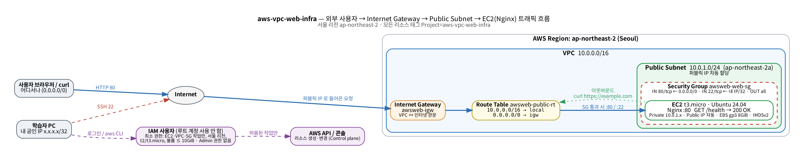
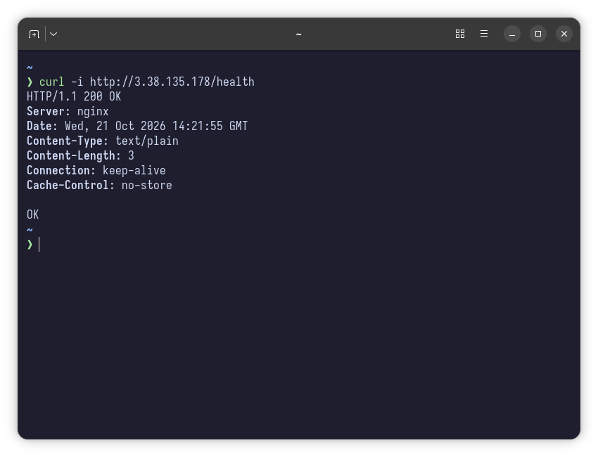

# aws-vpc-web-infra

> Web service deployment on AWS with a custom VPC, least-privilege IAM, and security group design, including troubleshooting and cleanup docs
> 직접 설계한 VPC, IAM 최소권한, 보안 그룹으로 구성한 AWS 웹 서비스 배포 및 트러블슈팅·리소스 정리 문서


서울 리전에 **VPC → Public Subnet → Internet Gateway → Route Table → Security Group → EC2(Nginx)** 를 직접 구성하고, 외부에서 `GET /health` 로 접속을 검증한 뒤, 리소스를 빠짐없이 정리하는 과정을 문서와 스크립트로 남겼습니다.

- **콘솔과 CLI 두 가지 경로** — [콘솔 가이드](docs/console-guide.md)를 따라 해도, `scripts/provision.sh` 한 번으로 해도 같은 결과
- **최소 권한을 코드로 강제** — 서울 리전 · t2/t3.micro · 볼륨 ≤ 10GiB 조건이 걸린 IAM 정책, `iam-check.sh` 로 허용·거부 경계를 **비용 없이**(EC2 dry-run) 검증
- **검증·정리 자동화** — `verify.sh`(라우팅·SG·/health·SSH 자동 판정), `cleanup.sh`(의존 관계 역순 삭제), `audit.sh`(리전 전체 과금 위험 리소스 0 확인)
- **재현 가능한 트러블슈팅** — 경로 누락·SSH IP 불일치·프로세스 중지·권한 거부를 일부러 일으키고 증상→가설→검증→조치→결과를 자동 기록

## 아키텍처



| 구성 | 값 |
| --- | --- |
| 리전 / AZ | ap-northeast-2 (서울) / ap-northeast-2a |
| VPC | `10.0.0.0/16` (`awsweb-vpc`) |
| Public Subnet | `10.0.1.0/24`, 퍼블릭 IP 자동 할당 (`awsweb-public-a`) |
| Internet Gateway | `awsweb-igw` → VPC attach |
| Route Table | `10.0.0.0/16 → local`, **`0.0.0.0/0 → igw`**, 서브넷 연결 (`awsweb-public-rt`) |
| Security Group | IN **80/tcp ← 0.0.0.0/0**, IN **22/tcp ← 내 IP/32**, 그 외 인바운드 없음 (`awsweb-web-sg`) |
| EC2 | `t3.micro`, Ubuntu 24.04 LTS, EBS gp3 8GiB, IMDSv2 필수, user-data 로 Nginx 설치 |
| IAM | 실습 전용 IAM 사용자 + [`iam/policy-least-privilege.json`](iam/policy-least-privilege.json) (AdministratorAccess 없음) |
| 태그 | 모든 리소스 `Project = aws-vpc-web-infra` (추적·정리 기준) |

트래픽 흐름과 설계 이유: [`docs/design.md`](docs/design.md)

## 외부 접속 검증 — 방식 B (`GET /health`)

| 항목 | 값 |
| --- | --- |
| **선택한 방식** | **방식 B: `GET http://<퍼블릭IP>/health` → `200 OK` + 고정 응답 `OK`** |
| 접속 정보 | `http://3.38.135.178/health` (2026-10-21 서울 리전 실습 당시 자동 할당 IP, 정리 후 반납) |
| 구성 | Nginx `location = /health { return 200 "OK\n"; }` ([`scripts/user-data.sh`](scripts/user-data.sh)) |
| 참고 | 같은 서버의 `/` 는 정적 페이지 "Hello Cloud" (방식 A 도 함께 확인 가능) |

```console
$ curl -i http://3.38.135.178/health
HTTP/1.1 200 OK
Server: nginx
Date: Wed, 21 Oct 2026 14:21:55 GMT
Content-Type: text/plain
Content-Length: 3
Connection: keep-alive
Cache-Control: no-store

OK
```

📸 접속 결과 스크린샷 ([`docs/images/06-health-200.png`](docs/images/06-health-200.png)) · 자동 검증 기록 [`verify-20261021-114519.txt`](docs/evidence/verify-20261021-114519.txt) (PASS 9 / FAIL 0)



> 실습이 끝나면 비용 방지를 위해 모든 리소스를 삭제하므로 **위 IP 는 현재 접속되지 않습니다.** 접속 사실은 스크린샷과 `docs/evidence/verify-*.txt` 로 증빙합니다.

B 를 고른 이유: 화면을 사람이 보는 A 와 달리 상태 코드와 본문을 **기계적으로 비교**할 수 있어 스크립트로 자동 검증되고, ALB 헬스 체크·모니터링이 쓰는 형태 그대로입니다.

## 빠른 시작

### 콘솔로 진행
[`docs/console-guide.md`](docs/console-guide.md) — 단계별 입력값과 스크린샷 지점(📸 01~07)

### CLI 로 진행 (AWS CLI v2, IAM 사용자 자격 증명)

```bash
aws configure                              # IAM 사용자 Access Key, 리전 ap-northeast-2
bash scripts/iam-check.sh                  # 최소 권한 경계 확인 (비용 없음)
DRY_RUN=1 bash scripts/provision.sh        # 실행할 명령 미리 보기 (AWS 호출 없음)
bash scripts/provision.sh                  # VPC ~ EC2 생성, /health 응답까지 대기
bash scripts/verify.sh                     # 요구사항 자동 검증 → docs/evidence/verify-*.txt
bash scripts/troubleshoot.sh route         # (선택) 장애 재현·기록 → docs/evidence/troubleshoot-*.txt
bash scripts/cleanup.sh                    # 역순 삭제 + audit → docs/evidence/audit-*.txt
```

| 스크립트 | 하는 일 |
| --- | --- |
| [`provision.sh`](scripts/provision.sh) | VPC → Subnet → IGW → RT(0.0.0.0/0) → SG(80 공개, 22 내 IP) → Key Pair → EC2. 생성 ID 를 `.state/resources.env` 에 기록, 중간에 실패해도 다시 실행하면 이어서 진행 |
| [`user-data.sh`](scripts/user-data.sh) | 첫 부팅: Nginx 설치, `/` 페이지·`/health`, `curl localhost` 200 과 아웃바운드(`example.com`) 자체 점검 |
| [`verify.sh`](scripts/verify.sh) | 라우팅·서브넷 연결, SG(80/22/전체 포트/기타), `/health` 200 OK, `/` 200, SSH 포트를 PASS/FAIL 판정 |
| [`iam-check.sh`](scripts/iam-check.sh) | t3.micro·서울 VPC 생성은 허용, t3.small·30GiB·us-east-1·S3·IAM·RDS 는 거부되는지 dry-run 으로 확인 |
| [`troubleshoot.sh`](scripts/troubleshoot.sh) | `route` / `ssh-ip` / `nginx` / `iam` 4가지 장애를 재현→진단→복구하며 기록 |
| [`cleanup.sh`](scripts/cleanup.sh) | EC2 → EIP → EBS → SG → RT → IGW → Subnet → VPC → Key Pair 순서로 삭제 |
| [`audit.sh`](scripts/audit.sh) | 리전 전체에서 EC2·EBS·EIP·NAT·스냅샷·태그 리소스를 조회해 0 확인 |

## 보안 그룹과 IAM

| | 규칙 | 이유 |
| --- | --- | --- |
| SG 80/tcp | `0.0.0.0/0` | 누구나 접속하는 웹 서비스 |
| SG 22/tcp | **내 IP/32** | 관리자만. 0.0.0.0/0 이면 수 분 내 무차별 대입 대상 |
| SG 그 외 | 없음 | 전체 포트 허용 금지 — 나중에 띄운 프로세스까지 공개된다 |
| IAM 서비스 | EC2 API(EC2·VPC·SG) + 권한 오류 해독(`sts:DecodeAuthorizationMessage`) | S3·RDS·IAM 등 실습과 무관한 서비스 없음 |
| IAM 조건 | 서울 리전만, 인스턴스 t2/t3.micro, 루트 볼륨 ≤ 10GiB | 리전 실수·큰 인스턴스 과금 사고 차단 |
| IAM 관리자 | 없음 | AdministratorAccess, `iam:*`, `iam:PassRole` 없음 |

선택 강화안: [`iam/policy-tag-scoped.json`](iam/policy-tag-scoped.json) — `Project` 태그 없는 리소스는 종료·삭제 불가, 태그 없이 생성 불가.

## 요구사항 구현 매핑

| 요구사항 | 구현 | 증빙 |
| --- | --- | --- |
| VPC 1개, Public Subnet 1개 | `provision.sh` 1·2단계 / 콘솔 가이드 1·2장 | 📸 04 · `verify.sh` |
| IGW 를 VPC 에 연결 | 3단계 | `audit.sh` / 📸 |
| Route Table `0.0.0.0/0 → IGW` | 4단계 | `verify.sh` 1번 · 📸 02 |
| 아웃바운드 통신 (`curl https://example.com`) | user-data 자체 점검 | `/var/log/user-data.log` · 📸 05 |
| EC2 1대, SSH 접속 | 6·7단계, Key Pair | 📸 05 |
| Nginx 실행, `curl localhost` 200 | user-data | 📸 05 |
| SG: 80 ← 0.0.0.0/0, 22 ← 내 IP, 전체 포트 금지 | 5단계 | `verify.sh` 2번 · 📸 03 · `tests/` |
| IAM 최소 권한, Admin 금지 | `iam/policy-least-privilege.json` | `iam-check.sh` · 📸 01 |
| 외부 접속 검증 (방식 B 명시) | `/health` | 이 README · 📸 06 · `verify-*.txt` |
| 정리: EC2/EBS/EIP/IGW/VPC | `cleanup.sh` + 체크리스트 | `audit-*.txt` · 📸 07 |
| 서울 리전, 프리 티어, 루트 계정 미사용 | `lib.sh` 리전 고정, 정책 조건, `preflight` 가 root 자격 증명 거부 | — |
| 제출물: 다이어그램 / 트러블슈팅 / 정리 체크리스트 | [`docs/architecture.png`](docs/architecture.png) · [`docs/troubleshooting.md`](docs/troubleshooting.md) · [`docs/cleanup-checklist.md`](docs/cleanup-checklist.md) | — |

체크리스트 질문별 답변: [`docs/checklist.md`](docs/checklist.md)

동료 평가 발표 슬라이드 65장: [`docs/presentation.html`](docs/presentation.html) (브라우저로 열기, ← → 넘기기 · N 발표자 노트 · 인쇄하면 PDF)

## 선택(보너스) 과제 구현 내역

| 보너스 | 구현 | 상태 |
| --- | --- | --- |
| **1. HTTPS 적용** | [`bonus/https/open-443.sh`](bonus/https/open-443.sh) (SG 443 + Elastic IP, `--revert` 로 정리), [`bonus/https/enable-https.sh`](bonus/https/enable-https.sh) (DNS 확인 → certbot `--nginx --redirect` → 자동 갱신 dry-run → 인증서 확인) | ✅ 2026-10-21 수행: `https://3-38-135-178.sslip.io` (sslip.io 무료 DNS + Let's Encrypt, 자동 갱신 dry-run 성공) · 📸 [`bonus-https-browser`](docs/images/bonus-https-browser.png), [`bonus-https-curl`](docs/images/bonus-https-curl.png) |
| **2. Docker 배포** | [`bonus/docker/user-data-docker.sh`](bonus/docker/user-data-docker.sh): 이미지 **`nginx:1.27-alpine`**, 실행 `docker run -d --restart unless-stopped -p 80:80 -v …:ro --health-cmd …`, **포트 매핑 호스트 80 → 컨테이너 80** | ✅ 2026-10-22 수행: 컨테이너 `healthy`, 외부 `/health` 200 · 📸 [`bonus-docker-ps`](docs/images/bonus-docker-ps.png), [`bonus-docker-health`](docs/images/bonus-docker-health.png) |

상세: [`docs/bonus.md`](docs/bonus.md)

## 실습 수행 기록 (2026-10-21 ~ 22, 서울 리전, IAM 사용자 `awsweb-student`)

| 단계 | 결과 | 증빙 |
| --- | --- | --- |
| IAM 최소 권한 확인 | `iam-check.sh` **PASS 10 / FAIL 0** (허용 4건, 범위 밖 6건 거부) | 📸 [01](docs/images/01-iam-user-policy.png) · 📄 [`iam-check`](docs/evidence/iam-check-20261021-113609.txt) |
| 구축 + 자동 검증 | `provision.sh` → `verify.sh` **PASS 9 / FAIL 0** | 📸 [02](docs/images/02-route-table.png) [03](docs/images/03-security-group.png) [04](docs/images/04-ec2-instance.png) · 📄 [`verify`](docs/evidence/verify-20261021-114519.txt) |
| SSH + 서버 안 확인 | nginx active, `localhost/health` 200, IMDSv1 401, `example.com` 200 | 📸 [05](docs/images/05-ssh-localhost.png) · 📄 [`ssh-inside`](docs/evidence/ssh-inside-20261021-114537.txt) |
| 외부 접속 (방식 B) | `GET /health` → `200 OK` | 📸 [06](docs/images/06-health-200.png) |
| 장애 재현 4종 | 경로 삭제 timeout(8초) / SSH IP 불일치 / Nginx 중지 refused(0.006초) / 권한 밖 UnauthorizedOperation | [`troubleshooting.md`](docs/troubleshooting.md) · 📄 `troubleshoot-*` |
| 보너스 1·2 | HTTPS(sslip.io + Let's Encrypt), Docker(`nginx:1.27-alpine`, healthy) | 📄 [`https`](docs/evidence/https-20261021-234351.txt) · [`docker`](docs/evidence/docker-20261022-000010.txt) |
| 정리 | `cleanup.sh` → `audit.sh` 과금 리소스 **0** | 📸 [07-ec2](docs/images/07-cleanup-ec2-terminated.png) [07-vpc](docs/images/07-cleanup-vpc-empty.png) [07-billing](docs/images/07-cleanup-billing.png) · [`cleanup-checklist.md`](docs/cleanup-checklist.md) · 청구 예정 **USD 0.00** (사용분 $0.24 는 크레딧 차감) |

증빙의 계정 ID·Access Key·내 공인 IP 뒷자리는 가렸습니다.

## 프로젝트 구조

```
aws-vpc-web-infra/
├── docs/
│   ├── architecture.png / .dot   # 아키텍처 다이어그램 (제출물)
│   ├── troubleshooting.md        # 트러블슈팅 보고서 (제출물)
│   ├── cleanup-checklist.md      # 리소스 정리 체크리스트 (제출물)
│   ├── console-guide.md          # 콘솔 단계별 가이드
│   ├── design.md                 # 네트워크 흐름, SG vs IAM, 최소 권한, 확장, 비용
│   ├── checklist.md              # 체크리스트 답변서
│   ├── bonus.md                  # 보너스 1·2
│   ├── images/                   # 스크린샷
│   ├── evidence/                 # verify / audit / iam-check / troubleshoot 실행 기록
│   └── presentation.html         # 동료 평가 발표 슬라이드
├── iam/                          # 최소 권한 정책, 태그 범위 강화안, 비용 조회 정책
├── scripts/                      # provision / verify / iam-check / troubleshoot / cleanup / audit / user-data
├── bonus/https/, bonus/docker/   # 보너스
└── tests/run-tests.sh            # 정적 검증 (AWS 계정 불필요)
```

## 테스트

```bash
bash tests/run-tests.sh
```

AWS 계정 없이 실행되는 정적 검증입니다: 모든 스크립트 `bash -n`·ShellCheck, IAM 정책이 최소 권한 규칙(관리자·와일드카드 변경·타 서비스 없음, 리전·타입·볼륨 조건)을 지키는지, `DRY_RUN` 으로 생성·삭제 **명령 순서**와 보안 그룹 규칙(22 는 /32, 전체 포트 없음)을 확인합니다. GitHub Actions 가 push 마다 실행합니다.
