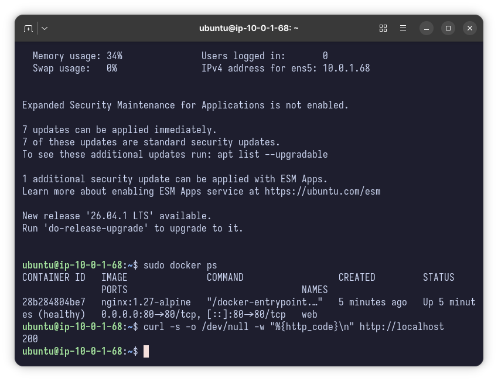
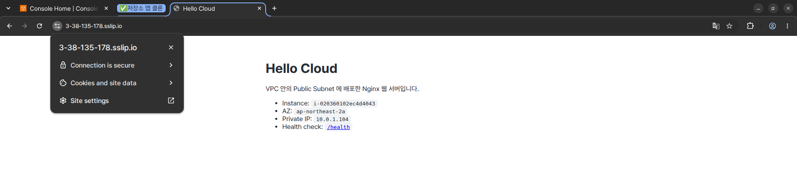

# 보너스 과제

| 보너스 | 구현 | 수행 결과 |
| --- | --- | --- |
| **1. HTTPS 적용** | [`bonus/https/open-443.sh`](../bonus/https/open-443.sh) (SG 443 + Elastic IP), [`bonus/https/enable-https.sh`](../bonus/https/enable-https.sh) (certbot, 자동 갱신, 리다이렉트) | ✅ 2026-10-21 `https://3-38-135-178.sslip.io` 200, 인증서 Let's Encrypt(YE1) ~2027-01-19 |
| **2. Docker 배포** | [`bonus/docker/user-data-docker.sh`](../bonus/docker/user-data-docker.sh) (Docker 설치 + `nginx:1.27-alpine` 실행, /health, 헬스체크, 자동 재시작) | ✅ 2026-10-22 `web nginx:1.27-alpine Up (healthy)`, 외부 `/health` 200 |

---

## 보너스 2 — Docker 컨테이너로 웹 서비스 배포

| 항목 | 값 |
| --- | --- |
| 이미지 | **`nginx:1.27-alpine`** (Docker Hub 공식 이미지) |
| 실행 방식 | user-data 가 첫 부팅에 `docker run -d --name web --restart unless-stopped -p 80:80 -v /opt/web/conf.d:/etc/nginx/conf.d:ro -v /opt/web/html:/usr/share/nginx/html:ro --health-cmd … nginx:1.27-alpine` |
| **포트 매핑** | **호스트 `80` → 컨테이너 `80`** (`-p 80:80`). 보안 그룹은 기본 과제와 같은 80 ← 0.0.0.0/0 그대로 |
| 설정 | `/health` → `200 OK` 고정 응답 (기본 과제와 동일), 정적 페이지 "running in Docker" |
| 운영 장치 | `--restart unless-stopped` (재부팅·크래시 후 자동 시작), `--health-cmd` (컨테이너 상태 `healthy` 표시), 설정은 읽기 전용(`:ro`) 마운트 |

```bash
USER_DATA=bonus/docker/user-data-docker.sh bash scripts/provision.sh   # 새로 만들 때
# 콘솔이라면: 인스턴스 시작 → 고급 세부 정보 → 사용자 데이터에 user-data-docker.sh 내용 붙여넣기
```

**검증 (README 에 스크린샷 2장 이상)**

```bash
# ① 인스턴스 안 (SSH)
docker ps --format 'table {{.Names}}\t{{.Image}}\t{{.Status}}\t{{.Ports}}'
# NAMES  IMAGE              STATUS                  PORTS
# web    nginx:1.27-alpine  Up 2 minutes (healthy)  0.0.0.0:80->80/tcp, :::80->80/tcp
curl -s -o /dev/null -w '%{http_code}\n' http://localhost      # 200 (필수)

# ② 외부 (내 PC)
curl -i http://<퍼블릭IP>/health                                # 200 OK / OK (필수)
```

**실제 수행 결과** (2026-10-22, 인스턴스 `i-06fd3c7d996a20681` / `43.203.233.147`, 기록 [`docker-20261022-000010.txt`](evidence/docker-20261022-000010.txt))

```text
NAMES     IMAGE               STATUS                   PORTS
web       nginx:1.27-alpine   Up 2 minutes (healthy)   0.0.0.0:80->80/tcp, [::]:80->80/tcp
restart=unless-stopped  mounts=/opt/web/conf.d->/etc/nginx/conf.d(ro) /opt/web/html->/usr/share/nginx/html(ro)
systemctl is-active nginx → inactive        # 호스트에는 Nginx 가 없다
0.0.0.0:80 LISTEN (docker-proxy)            # 80 을 듣는 건 Docker 포트 매핑
localhost → 200 / 외부 GET /health → HTTP/1.1 200 OK, OK
```

📸 [`bonus-docker-ps.png`](images/bonus-docker-ps.png) · [`bonus-docker-health.png`](images/bonus-docker-health.png)



**호스트 설치와 비교해 달라진 점**: Nginx 버전이 이미지 태그로 고정돼 어느 서버에서나 같은 결과가 나오고, 서버에는 Docker 만 있으면 됩니다. 반대로 컨테이너 로그는 `docker logs web` 으로 봐야 하고(호스트 `/var/log/nginx` 가 아님), 포트 매핑을 빠뜨리면 컨테이너는 떠 있는데 외부 접속은 안 되는(SG 가 아니라 호스트 포트 문제) 새로운 장애 유형이 생깁니다.

---

## 보너스 1 — HTTPS 적용 (무료 서브도메인 + Let's Encrypt)

**구성**

```
https://myweb.duckdns.org ──▶ DNS A 레코드 ──▶ Elastic IP ──▶ IGW ──▶ SG 443 ──▶ Nginx(:443, Let's Encrypt 인증서)
http://…  ──▶ Nginx(:80) ──301──▶ https://…          (인증 갱신용 /.well-known 은 80 으로 처리)
```

**절차**

1. **Elastic IP + 443 열기** (내 PC): `bash bonus/https/open-443.sh`
   퍼블릭 IP 는 인스턴스를 멈추면 바뀌므로, DNS 가 가리킬 고정 주소로 Elastic IP 를 씁니다.
2. **무료 서브도메인**: [DuckDNS](https://www.duckdns.org) 등에서 서브도메인 발급 → IP 를 1번의 Elastic IP 로 설정 → `nslookup <도메인>` 으로 반영 확인
3. **인증서 발급** (인스턴스 안):
   ```bash
   scp -i .state/awsweb-key.pem bonus/https/enable-https.sh ubuntu@<EIP>:~
   ssh -i .state/awsweb-key.pem ubuntu@<EIP> sudo bash enable-https.sh <도메인> <이메일>
   ```
   스크립트가 DNS 가 이 서버를 가리키는지 먼저 확인하고, `certbot --nginx --redirect` 로 인증서 설치·HTTP→HTTPS 리다이렉트, `certbot renew --dry-run` 으로 자동 갱신까지 확인합니다.
4. **검증**: 브라우저 `https://<도메인>` 자물쇠 / `curl -I https://<도메인>/health` → `HTTP/1.1 200 OK`
5. **정리**: `bash bonus/https/open-443.sh --revert` (443 규칙 제거 + **Elastic IP 릴리스**), DuckDNS 레코드 삭제

**실제 수행 결과** (2026-10-21, 기록 [`https-20261021-234351.txt`](evidence/https-20261021-234351.txt))

실습에서는 가입이 필요한 DuckDNS 대신 **sslip.io** 를 썼습니다. `3-38-135-178.sslip.io` 처럼 이름 안에 IP 를 적으면 그 IP 로 응답하는 무료 DNS 라 A 레코드 설정이 필요 없습니다. 인스턴스를 멈추지 않으므로 IP 가 바뀌지 않아 **Elastic IP 는 생략**했고(`open-443.sh` 대신 443 규칙만 추가), 정리할 EIP 도 생기지 않았습니다.

```text
$ curl -I https://3-38-135-178.sslip.io/health   → HTTP/1.1 200 OK
$ curl -I http://3-38-135-178.sslip.io/health    → HTTP/1.1 301, Location: https://…/health
$ curl -I http://3.38.135.178/health             → HTTP/1.1 200 OK   (기본 과제의 IP 접속은 그대로)
subject=CN=3-38-135-178.sslip.io  issuer=C=US, O=Let's Encrypt, CN=YE1  notAfter=Jan 19 13:39:42 2027 GMT
certbot.timer 등록 · certbot renew --dry-run → Congratulations, all simulated renewals succeeded
```

> 실행 중 발견해 고친 점: certbot `--redirect` 는 80 블록의 도메인 외 요청에 `return 404` 를 넣어 **기본 과제의 `http://<IP>/health` 가 404** 가 됐습니다. `enable-https.sh` 가 그 404 를 원래 설정(`/health` 200, 정적 페이지)으로 바꾸도록 수정해, 도메인 요청만 HTTPS 로 리다이렉트하고 IP 요청은 기존처럼 응답합니다.

크롬은 117 버전부터 주소창 자물쇠 대신 사이트 정보 아이콘을 보여 주므로, 아이콘을 눌러 **"Connection is secure"** 를 캡처했습니다.

📸 [`bonus-https-browser.png`](images/bonus-https-browser.png) · [`bonus-https-curl.png`](images/bonus-https-curl.png)



**주의**
- 80 포트를 닫으면 HTTP-01 인증과 갱신이 실패합니다. 80 은 리다이렉트용으로 유지합니다.
- Elastic IP 는 연결이 끊긴 상태로 남으면 과금됩니다. 정리 체크리스트 2번에 포함했습니다.
- Let's Encrypt 는 같은 도메인에 대한 발급 횟수 제한이 있으니 실패하면 원인(DNS·SG)을 먼저 고치고 다시 실행합니다.
