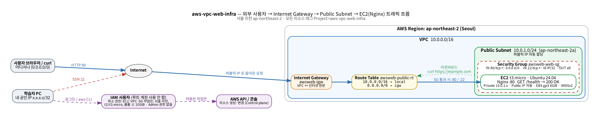

# 설계 문서



원본: [`architecture.dot`](architecture.dot) (재생성: `dot -Tpng -Gdpi=150 docs/architecture.dot -o docs/architecture.png`)

## 1. 구성 요소와 역할

| 구성 요소 | 값 | 역할 | 없으면 |
| --- | --- | --- | --- |
| **VPC** | `10.0.0.0/16` | 내 계정 안의 격리된 사설 네트워크. 다른 고객·다른 VPC 와 기본적으로 통신하지 않음 | 리소스를 둘 네트워크가 없음 |
| **Subnet** | `10.0.1.0/24`, ap-northeast-2a | VPC 를 AZ 단위로 나눈 구역. 인스턴스는 서브넷에 놓인다 | 인스턴스를 만들 수 없음 |
| **Internet Gateway** | VPC 에 1개 attach | VPC ↔ 인터넷 경계의 관문. 퍼블릭 IP ↔ 사설 IP 변환(1:1 NAT)도 여기서 일어남 | 인터넷과 통신 불가 |
| **Route Table** | `10.0.0.0/16 → local`, `0.0.0.0/0 → igw` | 서브넷에서 나가는 패킷의 다음 목적지를 결정 | IGW 가 있어도 응답이 나갈 길이 없음 |
| **퍼블릭 IP** | 서브넷 자동 할당 | 인터넷에서 인스턴스를 가리키는 주소 | 외부에서 찾아올 주소가 없음 |
| **Security Group** | 80 ← 0.0.0.0/0, 22 ← 내 IP/32 | 인스턴스(ENI) 단위 **상태 저장** 방화벽. 허용 규칙만 있음 | — (기본은 인바운드 전부 차단) |
| **EC2** | t3.micro, Ubuntu 24.04, 8GiB gp3, IMDSv2 | Nginx 웹 서버, `/health` 고정 응답 | — |
| **IAM 사용자** | 최소 권한 정책 | 누가 어떤 AWS API 를 호출할 수 있는지 | — |

"Public Subnet" 이라는 속성은 따로 없습니다. **라우팅 테이블에 `0.0.0.0/0 → IGW` 가 있는 서브넷**을 Public Subnet 이라고 부릅니다.

## 2. 외부 요청이 Nginx 까지 도달하는 흐름

```
① 브라우저가 http://<퍼블릭IP>/health 요청
② 인터넷 라우팅으로 AWS 서울 리전의 IGW 에 도착
③ IGW 가 목적지 퍼블릭 IP → 인스턴스 사설 IP(10.0.1.x) 로 변환
④ VPC 라우터가 10.0.0.0/16 → local 경로로 서브넷 안의 인스턴스로 전달
⑤ Security Group 인바운드 검사: TCP 80, 소스 아무 곳 → 허용
⑥ 인스턴스 OS → Nginx(:80) 가 "OK" 응답
⑦ 응답 패킷: SG 는 상태 저장이라 응답은 자동 허용 → 라우팅 테이블 0.0.0.0/0 → IGW
⑧ IGW 가 사설 IP → 퍼블릭 IP 로 변환해 인터넷으로 내보냄
```

외부에서 접속되려면 세 가지가 **모두** 필요합니다: **(1) 라우팅** `0.0.0.0/0 → IGW` (⑦ 응답이 나갈 길) **(2) 퍼블릭 IP** (① 찾아올 주소, ③ 변환 대상) **(3) 보안 그룹** 80 허용 (⑤). 하나라도 빠지면 클라이언트는 timeout 을 봅니다 → [`troubleshooting.md`](troubleshooting.md).

아웃바운드(`curl https://example.com`)는 ⑦⑧ 경로를 그대로 씁니다. 보안 그룹 아웃바운드는 기본 전체 허용이고, 들어오는 응답은 상태 저장으로 허용됩니다.

## 3. 보안 그룹 규칙을 최소화한 기준

| 포트 | 소스 | 허용 이유 | 다르게 하지 않은 이유 |
| --- | --- | --- | --- |
| 80/tcp | `0.0.0.0/0` | 누구나 접속해야 하는 웹 서비스 (요구사항) | — |
| 22/tcp | **내 IP/32** | 관리자 1명만 서버에 접속 | `0.0.0.0/0` 이면 전 세계 봇이 몇 분 안에 무차별 대입을 시작한다. 키 인증이라도 sshd 취약점·설정 실수 한 번이 곧 침해 |
| 443 | 없음 (보너스 1 에서만 추가) | 기본 과제는 HTTP | 쓰지 않는 포트는 연다고 얻는 것이 없다 |
| 그 외 | 없음 | — | **전체 포트(0-65535) 허용 금지**: 나중에 띄운 DB·관리 콘솔·디버그 서버가 의도치 않게 공개된다 |

DB 포트(3306/5432)를 0.0.0.0/0 으로 열지 않는 이유도 같습니다. DB 는 Private Subnet 에 두고 **보안 그룹을 소스로** 지정(예: "웹 서버 SG 에서 오는 5432 만 허용")하는 것이 표준입니다.

SSH 를 아예 닫는 대안: **EC2 Instance Connect Endpoint** 또는 **SSM Session Manager** (인바운드 22 없이 IAM 으로 접속 제어). 이번 과제는 SSH 접속이 요구사항이라 /32 제한으로 대응했습니다.

## 4. Security Group 과 IAM 의 차이

| | Security Group | IAM |
| --- | --- | --- |
| 무엇을 막나 | **네트워크 패킷** (누가 이 서버의 어떤 포트에 접속하나) | **AWS API 호출** (누가 어떤 리소스를 만들고·바꾸고·지울 수 있나) |
| 대상 | ENI (인스턴스) | 사용자·역할 |
| 판단 기준 | IP/CIDR, 포트, 프로토콜, 다른 SG | Action, Resource ARN, Condition (리전·태그·인스턴스 타입 …) |
| 예 | "아무나 80 으로 접속 가능" | "이 사용자는 서울 리전에서 t3.micro 만 띄울 수 있다" |
| 뚫리면 | 서버 하나가 공격받음 | **계정 전체**가 위험 (리소스 생성으로 과금 폭탄, 데이터 삭제) |

둘은 서로를 대신하지 않습니다. SG 를 완벽히 막아도 IAM 이 과하면 누군가 SG 규칙 자체를 열 수 있고, IAM 을 잘 막아도 SG 가 열려 있으면 서버가 공격받습니다.

## 5. IAM 최소 권한 설계

[`iam/policy-least-privilege.json`](../iam/policy-least-privilege.json)

| 원칙 | 정책에서의 구현 |
| --- | --- |
| 필요한 서비스만 | `ec2:*` 계열(EC2·VPC·SG 는 모두 EC2 API) + `sts:DecodeAuthorizationMessage`(권한 오류 해독). S3·RDS·IAM 없음 |
| 필요한 작업만 | 조회는 `ec2:Describe*`, 변경은 VPC/Subnet/IGW/RT/SG/EC2/KeyPair/EIP/볼륨 삭제 작업을 **하나씩 나열** (와일드카드 없음) |
| 필요한 리전만 | 모든 `Resource: "*"` 문장에 `aws:RequestedRegion = ap-northeast-2` 조건 |
| 필요한 크기만 | `RunInstances` 는 `ec2:InstanceType ∈ {t2.micro, t3.micro}`, 루트 볼륨 `ec2:VolumeSize ≤ 10` 조건 → 실수로 큰 인스턴스를 띄워 과금되는 사고 차단 |
| 관리자 권한 없음 | `AdministratorAccess`, `iam:*`, `iam:PassRole` 없음 |
| (선택) 태그 범위 | [`policy-tag-scoped.json`](../iam/policy-tag-scoped.json): `Project` 태그가 없는 리소스는 종료·삭제 불가, 태그 없이 생성 불가 (Deny) |

**검증**: [`scripts/iam-check.sh`](../scripts/iam-check.sh) 가 EC2 `--dry-run` 으로 허용(t3.micro, 서울 VPC 생성)과 거부(t3.small, 30GiB 볼륨, us-east-1, S3, IAM, RDS)를 비용 없이 확인합니다.

**권한이 부족할 때 최소 범위를 찾는 방법**
1. 오류의 인코딩 메시지를 `aws sts decode-authorization-message` 로 해독 → 정확한 `action`, `resource`, 걸린 `condition` 확인
2. 그 Action 하나만, 가능한 Resource ARN·조건을 붙여 추가 (서비스 전체 `ec2:*` 나 Admin 으로 올리지 않음)
3. 일정 기간 사용 후 IAM Access Advisor / CloudTrail 로 실제 쓴 Action 만 남기고 줄인다
4. 정책 변경은 `iam-check.sh` 로 허용·거부 경계가 그대로인지 다시 확인

## 6. 외부 접속 검증 방식 선택: B (`/health`)

| | (A) 브라우저 `/` | **(B) `GET /health`** |
| --- | --- | --- |
| 확인 방법 | 사람이 화면을 봄 | `curl` 로 상태 코드 + 본문 비교 (자동화 가능) |
| 실무 대응 | — | ALB 대상 그룹 헬스 체크, 모니터링, 배포 파이프라인이 쓰는 형태 그대로 |
| 구성 | Nginx 기본 페이지 | Nginx `location = /health { return 200 "OK\n"; }` — 파일·백엔드 없이 고정 응답 |

B 를 선택했고, 같은 서버에서 A(`/` 정적 페이지)도 함께 응답하게 만들었습니다. `verify.sh` 가 둘 다 확인합니다.

## 7. 확장: 인스턴스를 2대로 늘린다면

현재 구조의 병목과 단일 장애점:

| 문제 | 현재 | 추가할 구성 |
| --- | --- | --- |
| 진입점이 인스턴스 퍼블릭 IP | 2대면 주소가 2개, 하나가 죽으면 그쪽 사용자는 실패 | **ALB** 1개를 진입점으로, 인스턴스는 대상 그룹에 등록. ALB 가 `/health` 로 헬스 체크해 죽은 인스턴스를 자동 제외 |
| AZ 하나 | ap-northeast-2a 장애 시 전체 중단 | Public Subnet 을 **2a·2c 두 AZ** 에 (ALB 는 최소 2 AZ 필요) |
| 인스턴스가 인터넷에 직접 노출 | SG 80 ← 0.0.0.0/0 | 인스턴스를 **Private Subnet** 으로 옮기고 SG 80 ← **ALB SG** 만 허용. 아웃바운드는 NAT Gateway (과금 주의) |
| 수동 확장 | 손으로 띄움 | Launch Template + **Auto Scaling Group** (user-data 재사용) |
| 서버별 상태 | 로컬 디스크 | 세션·파일은 외부 저장소(ElastiCache, S3, RDS)로 |

## 8. 비용: 예상치 못한 청구가 생기면

의심 순서(과금이 크거나 잊기 쉬운 것부터):

1. **NAT Gateway** — 시간당 + GB 처리량. "VPC 등" 마법사가 자동 생성
2. **연결되지 않은 Elastic IP** — 인스턴스를 종료해도 남는다
3. **다른 리전의 인스턴스** — 리전을 바꿔 작업한 흔적
4. **EBS 볼륨/스냅샷** — `available` 볼륨, 오래된 스냅샷
5. ALB, RDS — 만들었다면 시간당
6. 프리 티어 한도 초과 — 인스턴스 2대를 동시에 켜면 750시간/월을 두 배 속도로 소진

추적: Billing → Cost Explorer 에서 **서비스별·리전별·사용 유형별**로 그룹화 → 원인 서비스·리전 특정 → 해당 리전 콘솔에서 리소스 확인 → 삭제 → `audit.sh`. 재발 방지는 AWS Budgets 로 월 $1 같은 낮은 예산 알림을 걸어 두는 것입니다.
